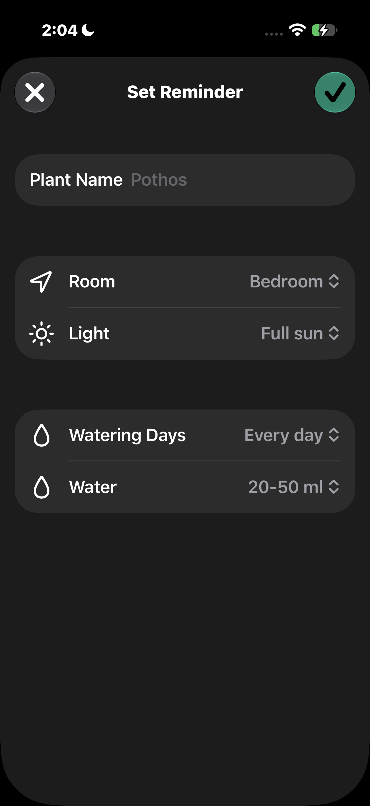
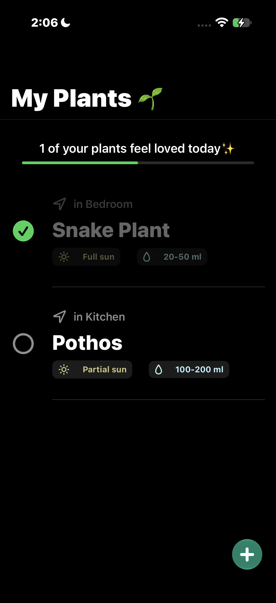

<h1 align="center">🌱 Planto</h1>
  

An iPhone app that helps you take care of your plants. 
Add each plant with how often it needs water, and Planto reminds you when it is time.

## Main Features

- Add a plant with its name, room, light, watering day and water amount
- Edit or delete a plant by tapping its card, or swipe the card to delete it
- Check off each plant when you water it and watch the progress bar fill
- See an "All Done" screen when every plant has been watered
- Get a notification reminding you to water your plants

## Screenshots

  
  
  
  
  

## Technologies Used

- **Swift** and **SwiftUI** for the app and its interface
- **MVVM** to keep the data, logic and screens separate
- **UserNotifications** for the watering reminders

## Resources

- [SwiftUI documentation](https://developer.apple.com/documentation/swiftui)
- [UserNotifications documentation](https://developer.apple.com/documentation/usernotifications)
- [The Swift Programming Language](https://docs.swift.org/swift-book/)

I used Claude as a learning partner for hints and explanations, and I built and tested the app myself.

---

**Raghad Ibrahim Alshiban**
