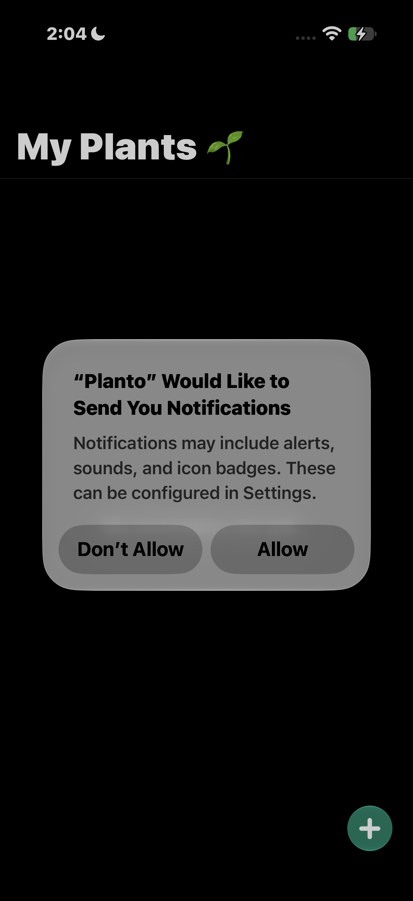
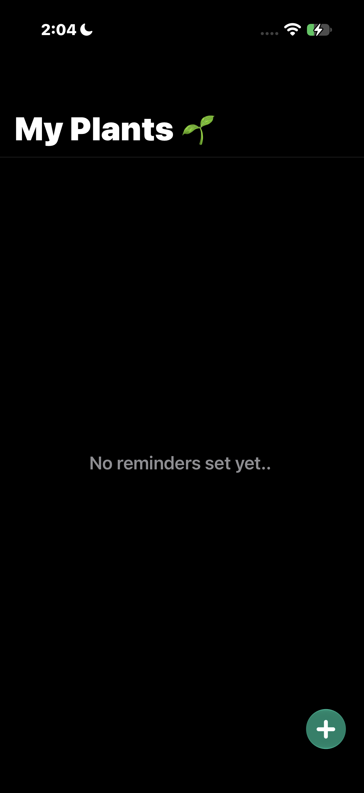
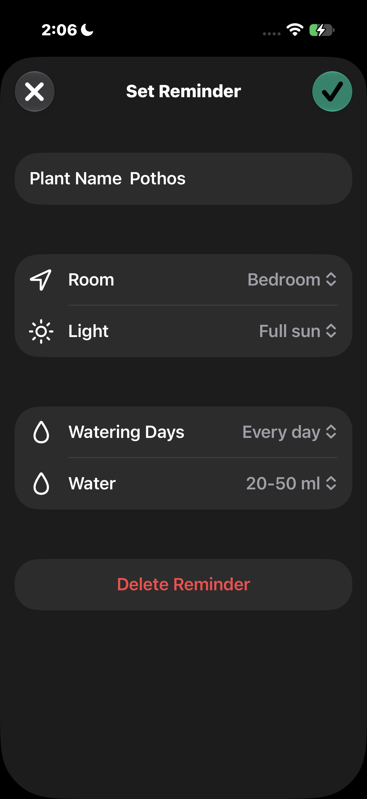
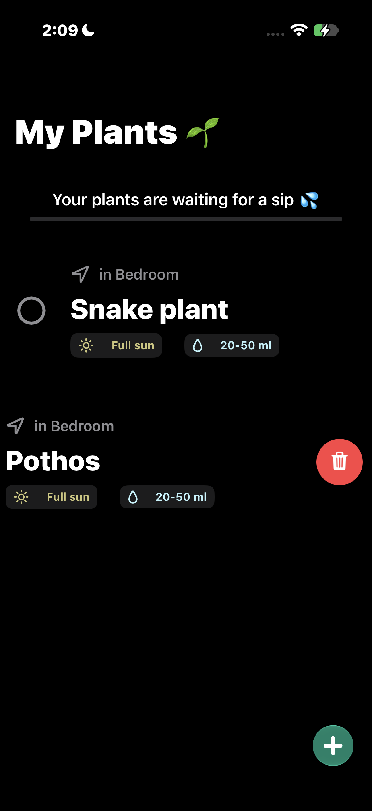
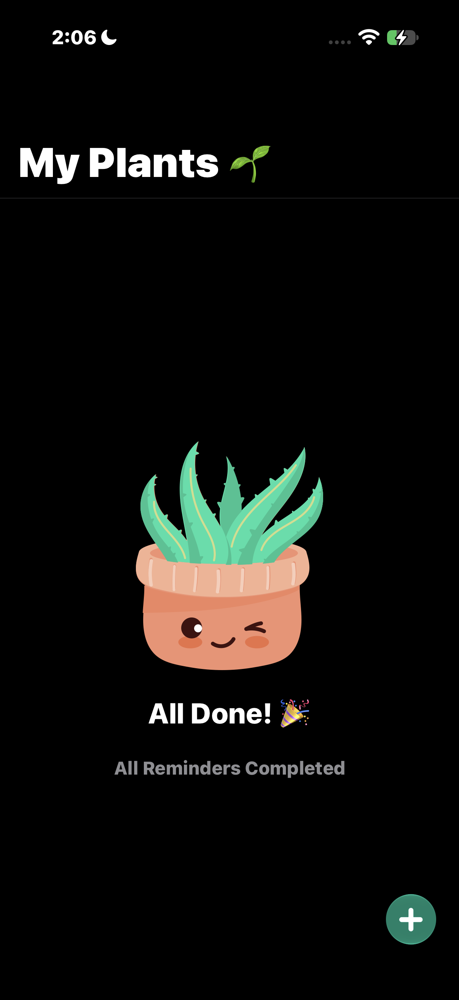

<div align="center">

# 🌱 Planto

**A simple iOS app that reminds you when to water your plants.**


</div>

---

## 📱 Screenshots

<div align="center">

| Welcome | Notifications | Empty State | Add Reminder |
|:---:|:---:|:---:|:---:|
|  |  |  |  |

| Edit / Delete | My Plants | Swipe to Delete | All Done 🎉 |
|:---:|:---:|:---:|:---:|
|  |  |  |  |

</div>

---

## ✨ Features

- **Add a plant reminder** with its name, room, light, watering day and water amount.
- **Edit or delete** a reminder. Tapping a card opens the same sheet used for adding.
- **Check off** a plant when you water it. The progress bar updates automatically.
- **Swipe to delete** a single plant card.
- **Local notifications** remind you on the watering day you chose.
- **Empty state and "All Done" screen** so the app always tells you what to do next.
- **Dark mode** design.

---

## 🛠 Built With

| Tool | Used for |
|---|---|
| **Swift** | The programming language |
| **SwiftUI** | The user interface (layouts, forms, lists, sheets) |
| **MVVM** | App architecture (Model, View, ViewModel) |
| **UserNotifications** | Local watering reminders |

### SwiftUI concepts practiced

`VStack` · `HStack` · `ZStack` · `Form` · `Section` · `Picker` · `TextField` · `List` · `ForEach` · `.sheet` · `.toolbar` · `.swipeActions` · `ProgressView` · `Button` · `@State` · `@Binding`

### Swift and MVVM concepts practiced

`struct` · `enum` (`CaseIterable`, `Identifiable`, `rawValue`) · `ObservableObject` · `@Published` · `@StateObject` · `@ObservedObject` · `$` bindings · optionals (`UUID?`) · closures (`firstIndex`, `removeAll`)

---

## 🧱 Project Structure

```
Planto
├── PlantoApp.swift          # App entry point
├── Model
│   ├── PlantoName.swift     # Plant struct
│   └── TheContent.swift     # Enums: Room, Light, WateringDay, Water
├── View
│   ├── Start.swift          # Welcome screen
│   ├── SetReminder.swift    # My Plants screen
│   ├── PlantCard.swift      # One plant card
│   └── AddPlantSheet.swift  # Add / edit sheet
├── ViewModel
│   └── ReminderView.swift   # State and logic (add, update, delete, notifications)
└── Assets.xcassets
```

**How MVVM is used here:** the **Model** holds the plant data, the **Views** only show it, and the **ViewModel** holds the state and the logic. When the ViewModel changes, SwiftUI updates the screen.

---

## 🚀 Getting Started

1. Clone the repository:
   ```bash
   git clone https://github.com/<your-username>/Planto.git
   ```
2. Open `Planto.xcodeproj` in Xcode.
3. Choose an iPhone simulator and press **Run** (`⌘R`).
4. Allow notifications when the app asks.

> **Requirements:** Xcode and an iOS version that supports the glass button style (iOS 26 or later).

---

## 🔭 Next Steps

- Save plants permanently so they remain after closing the app.
- Reset the checkmarks every day.
- Let the user choose the exact time of the notification.
- Customize the progress bar and polish light mode.

---

## 📚 Resources

- [SwiftUI documentation – Apple](https://developer.apple.com/documentation/swiftui)
- [UserNotifications documentation – Apple](https://developer.apple.com/documentation/usernotifications)
- [The Swift Programming Language – Swift.org](https://docs.swift.org/swift-book/)
- [Human Interface Guidelines – Apple](https://developer.apple.com/design/human-interface-guidelines/)
- Course slides and class examples on MVVM
- Sketch design mockups for the screens

### 🤖 AI use

I used Claude as a learning partner. It gave hints, explanations and review questions, and I wrote and tested the app myself. Some functions were written with AI help, and I reviewed them and can explain them.

---

## 👩‍💻 Author

**Raghad Ibrahim Alshiban**
