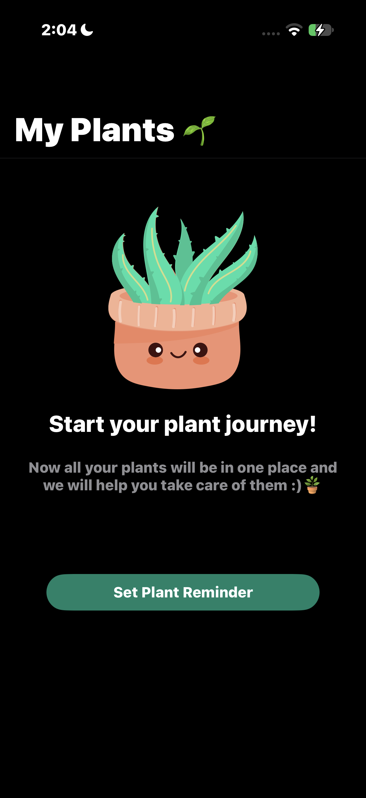

# 🌱 Planto

A simple iPhone app that reminds you to water your plants.

 

    

 

## Features

- Add a plant with its room, light, watering day and water amount
- Tap a plant to edit it, or swipe to delete it
- Check off a plant when you water it and see your progress
- Get a notification when it is time to water

## Built With

- **Swift** and **SwiftUI** for the app and its interface
- **MVVM** to keep the data, logic and screens separate
- **UserNotifications** for the reminders

## Run It

Open `Planto.xcodeproj` in Xcode, choose an iPhone simulator, and press **Run**.

## Resources

- [SwiftUI documentation](https://developer.apple.com/documentation/swiftui)
- [UserNotifications documentation](https://developer.apple.com/documentation/usernotifications)
- [The Swift Programming Language](https://docs.swift.org/swift-book/)

I used Claude as a learning partner for hints and explanations, and I built and tested the app myself.

 

**Raghad Ibrahim Alshiban**
